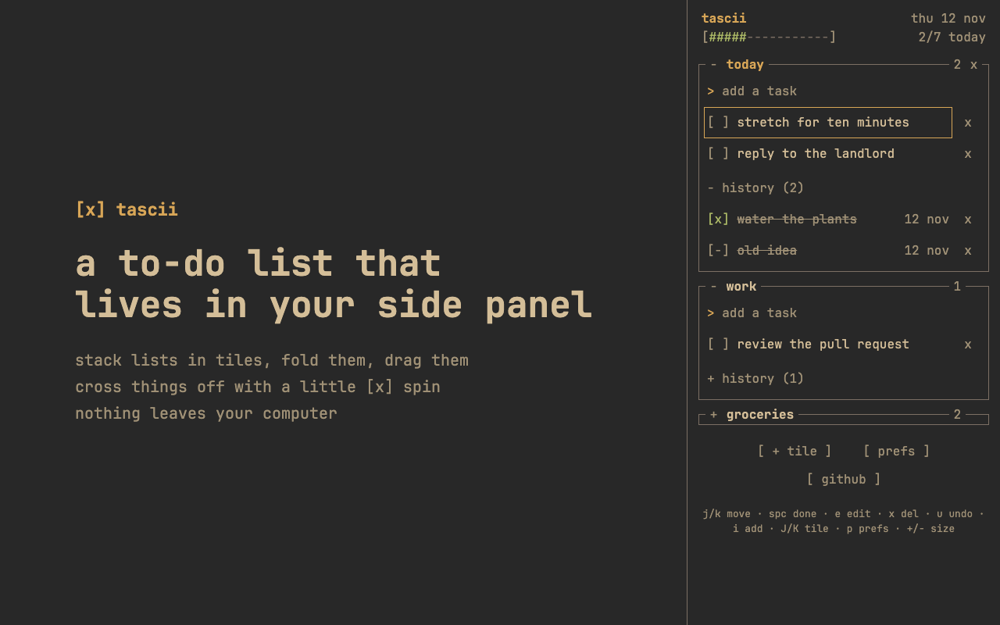

# tascii

A minimalist to-do list that lives in Chrome's side panel, drawn in plain ASCII.

**[tascii-list.com](https://tascii-list.com)** has a live demo you can try without installing anything. The Chrome Web Store listing is in review.

## What it does
- **Opens instantly.** Click the toolbar icon and your lists are there. No framework or libraries: the whole extension is about 13 KB compressed.
- **Lists in tiles.** Stack as many lists as you like (today, work, groceries). Rename them, fold them, drag them into order.
- **Satisfying to finish.** Crossing a task off spins `[ ]` to `[x]`, throws a few ASCII sparks, strikes the words through and moves it to that list's history.
- **Nothing is lost by accident.** Deleted tasks go to history as `[-]`, and `u` undoes the last delete, even a whole list.
- **Edit in place.** Click a task's words to fix a typo.
- **Progress for today:** `[#####-----------] 2/7 today`.
- **Keyboard first.** Everything works from the keys below.
- **Your look.** Three themes (gruvbox, dark, light) that wipe across when you switch, and text sizes from 13 to 26px.

## Install
From the Chrome Web Store once the listing is approved. Until then:
1. Download this repo and open `chrome://extensions`.
2. Turn on **Developer mode**, click **Load unpacked** and pick the folder.
3. Pin tascii and click its icon.

## Keys
| Key | Does |
|---|---|
| `j` / `k` | move down / up |
| `h` / `l` | move between a task and its delete button |
| `space` | cross off (or bring back, in history) |
| `e` | edit the words |
| `x` / `u` | delete / undo |
| `i` | add a task |
| `J` / `K` | move a list down / up |
| `N` / `r` | new list / rename list |
| `p` | prefs (theme and text size) |
| `+` / `-` | bigger / smaller text |

If the keys do nothing, click the panel first: the line at the bottom says so when the web page has your keyboard.

## Private
Tasks are saved in your browser and never leave your computer. No account, no tracking, no network requests. The extension asks for two permissions, the side panel and storage, so it can't see the pages you visit. [Privacy policy](https://tascii-list.com/privacy).

## How it's built
Plain HTML, CSS and JavaScript, with no build step and no dependencies.

| Path | What it is |
|---|---|
| `manifest.json`, `background.js` | the extension's setup; clicking the icon opens the side panel |
| `panel.html`, `panel.css`, `panel.js` | the to-do list |
| `prefs.js` | theme and text size, shared with the website |
| `tests/` | the test suite |
| `store/` | Chrome Web Store listing text and images |
| `site/` | tascii-list.com, whose demo is this same panel |
| `PLAN.md` | what's been built, version by version, and what's next |

## Develop
- `node tests/run.mjs` runs the tests (needs Chrome). They check the permissions and security policy, ban unsafe code patterns, then run the panel in headless Chrome against HTML injection, corrupted data and every feature.
- `./pack.sh` runs the tests and builds the Chrome Web Store zip.
- `node store/render.mjs` redraws the icons, store images and the picture above.
- `sh site/build.sh` builds the website into `site/dist`. Cloudflare runs it on every merge to `main`.

Releases are tagged: `vX.Y.Z` for the extension (always matching `manifest.json`) and `site-vX.Y.Z` for the website.

## What's next
A tiling version for the web at tascii-list.com/app: many lists open at once, laid out like the Hyprland window manager, all resizing to fit the window. The phases are in [PLAN.md](PLAN.md).
