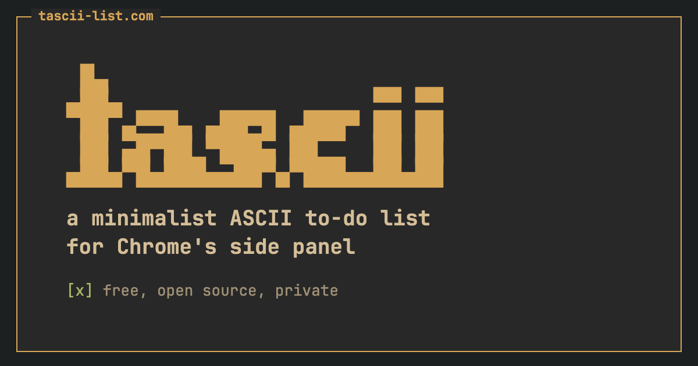

# tascii

A minimalist ASCII to-do list for Chrome's side panel. Try it at **[tascii-list.com](https://tascii-list.com)**.

## Install
1. Open `chrome://extensions` and turn on **Developer mode**.
2. Click **Load unpacked** and pick this folder.
3. Pin tascii and click its icon.

## Use
- Type a task and press Enter. Click its `[ ]` to cross it off.
- Click a task's words to edit them.
- `[ + tile ]` adds another list. Drag a list's top bar to move it.
- Finished and deleted tasks go to each list's history, so nothing is lost.
- `[ prefs ]` picks the theme (gruvbox, dark, light) and text size.

## Keys
| Key | Does |
|---|---|
| `j` / `k` | move down / up |
| `space` | cross off |
| `e` | edit |
| `x` / `u` | delete / undo |
| `i` | add a task |
| `J` / `K` | move a list |
| `N` | new list |
| `p` | prefs |

## Private
Tasks are saved in your browser and never leave your computer. No account, no tracking, no network requests.

## Develop
- `node tests/run.mjs` runs the tests (needs Chrome).
- `./pack.sh` builds the Chrome Web Store zip.
- `sh site/build.sh` builds the website into `site/dist`.
